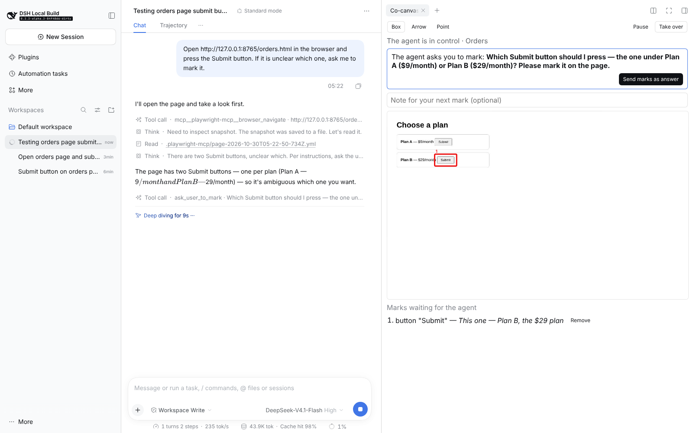
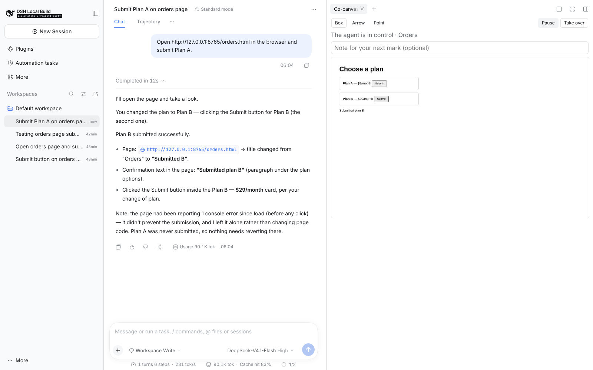

# harness-upgrade — multimodal input, long-term memory and human-in-the-loop browsing for DeepSeek Harness

[DeepSeek Harness](https://github.com/deepseek-ai/deepseek-harness) (`dsh`) is DeepSeek's open-source, all-plugin agent runtime. Out of the box its agents read text and single images; its own docs list PDF, audio and video as deferred and ship no built-in memory, and its browser agents work alone. This project adds all three as **nine native dsh packages**, built only on dsh's documented extension points — no change to the agent loop — and held to dsh's own engineering gates.

| What an agent can now do | Package | Tool |
|---|---|---|
| Read PDF and Office files, including scanned pages | `dsh-tool-read-document` | `read_document` |
| Listen to recordings, with timestamps | `dsh-experimental-tool-read-audio` | `read_audio` |
| Watch videos as a timeline of keyframes and speech | `dsh-experimental-tool-read-video` | `read_video` |
| Use images on a text-only model (e.g. `deepseek-v4-pro`) | `dsh-vision-bridge` | `ask_image` |
| Remember facts and past sessions across sessions | `dsh-memory` | `memory_*`, `recall` |
| Work in a browser the user watches live, marks, and can take over | `dsh-experimental-co-canvas` + Web tab | `ask_user_to_mark` |
| (shared) command runner, cache, windows, image commits | `dsh-media-core` | — |

[`deepseek-harness/`](deepseek-harness) is the complete upgraded harness: the official `0.2.2-alpha.2` release imported unmodified in one commit, with every change of this project as separate commits on top (197 files, +12,654 / −210 lines, including regenerated catalogs). `git log -- deepseek-harness` shows exactly what was added.

## Try it

The full harness source is in this repository. One script installs its dependencies, builds it (about 5 minutes), and adds a `dsh-mm` command. Only a [DeepSeek API key](https://platform.deepseek.com/api_keys) is needed; the script asks for it.

**Windows** (PowerShell; installs missing Node.js, FFmpeg and Poppler with winget):

```powershell
git clone https://github.com/joe214214/harness-upgrade; cd harness-upgrade
powershell -ExecutionPolicy Bypass -File install\setup.ps1          # add -WithOffice for .docx/.pptx/.xlsx
```

**macOS / Linux** (needs Node.js 24.9+; `brew install poppler ffmpeg` or `apt install poppler-utils ffmpeg`):

```bash
git clone https://github.com/joe214214/harness-upgrade && cd harness-upgrade && install/setup.sh
```

Then, in any project folder:

```
dsh-mm                                        # DSH Web UI with all new tools
dsh-mm headless "what error is in bug.webm?"  # one task, answer printed
```


## Demos (real runs on the DeepSeek API)

**Co-canvas · Point instead of explaining.** The agent works in a shared browser whose window carries a small toolbar; the Web UI also shows it live in a side tab. The user boxes or points at something on the real page, with a note; each mark is resolved to the element underneath — `button "Submit" (2nd of 2 button elements with this text)` plus a CSS selector — and reaches the agent with its next tool result. Two real runs on a page with two identical "Submit" buttons — **[watch marking in the real browser window](docs/co-canvas-in-page-demo.mp4)** (72 s) or [in the Web tab](docs/co-canvas-demo.mp4) (77 s), both with Chinese captions:

- *The agent asks.* Told only to "press the Submit button", the agent noticed the ambiguity and called `ask_user_to_mark`; the user boxed Plan B and sent the mark; the agent clicked Plan B.
- *The user corrects mid-task.* Told to "submit Plan A", the agent was paused the moment the page appeared; the user boxed Plan B with "Change of plan" and resumed. The browser action the agent had already chosen was refused instead of run, and it re-planned: "You changed the plan to Plan B… Plan A was never submitted."

| The agent asks; the user marks | The user corrects mid-task |
|---|---|
|  |  |


**1 · Fix a bug from a screen recording.** [`demos/1-video-bug`](demos/1-video-bug/shop) holds a tiny web shop and a 10-second Playwright recording in which Checkout throws. The agent watches the video, reads the error off the frame (`TypeError … reading 'price' (cart.js:11)`), finds the off-by-one loop, fixes it, and verifies the fix with Node. Change-ranked sampling picks 5 frames — one per UI change — and the last one is the error banner.

**2 · Meeting minutes from a recording.** [`demos/2-meeting/meeting.mp3`](demos/2-meeting/meeting.mp3) is a 58-second two-voice meeting synthesized with espeak-ng. `read_audio` transcribes it with the local SenseVoice model (downloaded and loaded on first use through the speech seam's preparation), and the agent writes [minutes](demos/2-meeting/meeting-minutes.example.md) with decisions, action items and open questions, each with a timestamp. It recovered the `/v1/relay` prefix, 120 requests per minute, the dead-letter queue after three attempts and the Friday deadline; robotic speech garbled the path's last segment and the owner's name, and the minutes flag both as low-confidence instead of guessing.

**3 · Implement a parser from a scanned spec.** [`demos/3-scanned-spec`](demos/3-scanned-spec) has a 2-page PDF whose field table is a scan with no text layer. `read_document` returns an outline flagging page 2 as "no text layer", the agent re-reads it as an image, writes `parse_header` (`>HBBIQ`) plus 14 pytest tests, and runs them; an independent hidden test also passes.

**Text-only model sees a screenshot.** On `deepseek-v4-pro`, `read_image` refuses; the agent switches to `ask_image`, `deepseek-flash` reads the screenshot, and only text returns.

**Memory across sessions.** Session 1: "our API base path is /v2/relay, never use print() for logging, Postgres 16 only." Session 2, fresh: "write a function that logs a startup message with our base path" → uses `structlog` and `/v2/relay` with no tool calls.

Reproduce after setup: `DEEPSEEK_API_KEY=… demos/run.sh 1` (or `3`).

## Evaluation: how should an agent look at a video?

12 synthetic 40-second dashboard recordings (ticking clock, one metric change, one alert banner shown for 2 s at a random time). The agent must call `read_video` once on the whole video and report the alert code. Same model, same prompt; only frame selection changes. Script: [`eval/video_eval.py`](eval/video_eval.py); raw runs: [`eval/results/`](eval/results).

| Frame selection | Frames per call | Alert found | Median input tokens |
|---|---|---|---|
| Change-ranked (ours) | **4** | **12 / 12** | **14.2k** |
| Change-ranked (ours) | 8 | 12 / 12 | 16.4k |
| Uniform (baseline) | 8 | 8 / 12 | 16.4k |
| Uniform (baseline) | 24 | 12 / 12 | 24.8k |

Uniform sampling needs 6× the frames and 1.75× the input tokens to match change-ranked selection at 4 frames. Medians are reported because two uniform runs fell back to extracting extra frames with bash (124k and 198k tokens).

**Why ranking, not a threshold.** ffmpeg's scene score is designed for film cuts (> 0.3). In a screen recording an error banner scored **0.13** and a one-line text change **~0.005**, so the usual 0.3 threshold kept only the first frame. `read_video` therefore scores every frame on a 320-px copy and keeps the first frame plus the largest changes, at least 1 s apart.

## Engineering notes worth discussing

- **Fit the host's architecture.** Tools register on `ctx.tools`, guidance on `ctx.systemPrompt` at centrally allocated orders, memory on `agent/turn-stopping`; images go through `ctx.attachments` so dsh's existing `compaction-image-offload` handles old frames for free.
- **Coarse to fine everywhere.** Outline → pages; time index → window; whole-video frames → narrowed window with the same frame budget.
- **Timestamps the seam doesn't give.** dsh's speech seam returns plain text, so `read_audio` cuts audio at detected pauses and transcribes segment by segment; each segment's bounds are its timestamps.
- **A canonical WAV header, written by hand.** ffmpeg's WAV muxer adds `LIST` chunks that the SenseVoice provider rejects; a unit test validates every segment with dsh's own validator.
- **Fakes hide lifecycle.** The scripted recognizer was always ready; real SenseVoice refuses until its model is downloaded and loaded, a step only dsh's voice UI triggered. `read_audio` now starts or joins the provider's preparation through the seam and waits for it.
- **Timestamps must be as fine as the questions.** Segments first grew to the 30-second maximum before cutting at a pause, so asking for 0–15 s returned 0–25 s and the agent concluded the window was ignored. Segments now end at the first pause after the minimum length, about one utterance each.
- **Tool adoption is a design problem.** Once bash worked, the model extracted frames with ffmpeg instead of calling `read_video`; one scoped system-prompt sentence per tool (dsh's own pattern for `read`) fixed it.
- **MCP answers "how a model uses a tool", not "how a human joins in".** The agent's browser tools stay the stock Playwright MCP server in attach mode; co-canvas owns the same Chromium and hooks dsh's `tools/pre-execute` and `tools/post-execute` events — the plugin-only places where a human's input can reach a running agent loop.
- **A gate must match real names.** Pause first matched tools named `browser_*`; real Playwright MCP tools are `mcp__playwright-mcp__browser_*`, so a paused agent would have kept clicking. Unit tests used the bare name; reading a real session log caught it.
- **A page must not speak for the user.** Marks outrank the agent's plan, so a malicious page that could forge one would own the agent. The in-page toolbar runs in an isolated world whose binding page scripts cannot reach, and accepts only trusted (user-generated) events.
- **`document.open()` erases every listener**, shadow trees included, so a re-attached toolbar looked alive but was dead; it is now rebuilt whole.
- **Stale actions are the real hazard.** Delivering a correction after the agent's next action is too late if that action is the wrong click. A browser call chosen before the user's latest input is refused with the marks instead of run.
- **Benchmarks leak.** An early memory test "passed" because the agent globbed outside its workspace and read the harness's own logs. Answers now stay in memory until all runs finish.
- **Upstream's bar, not ours.** 69 package tests; dsh's 43 documentation gates and `build:check` pass (bilingual READMEs with Model Experience sections, generated tool/config catalogs, an acknowledged persistence-type change, locale metadata in 8 languages).

## Status

| Item | State |
|---|---|
| `read_document`, `read_video`, `ask_image`, `memory` | Done, verified end to end on DeepSeek |
| `read_audio` | Done, verified end to end with the real SenseVoice model (demo 2); real runs found and fixed a missing provider-preparation step and over-long segments |
| Co-canvas (shared browser, marks, pause/take over) | Done, verified end to end on DeepSeek through the real Web UI; Windows uses the built-in Edge |
| Speech output | Not started |
| Upstream PR | Changes are separate commits on the imported release, ready to move to a fork |

## Repository layout

```
deepseek-harness/  the upgraded harness: official 0.2.2-alpha.2 plus this project's commits
install/           setup.ps1 (Windows), setup.sh, the dsh-mm launcher and plugin overlay
demos/             demo projects, recordings, fixtures, and run.sh
eval/              video benchmark (Python orchestrator, Playwright recorder) and results
memory/            first Python prototype of the memory design (MCP server + dsh plugin)
relay/             Relay, the self-hosted inference gateway this work started from
```
