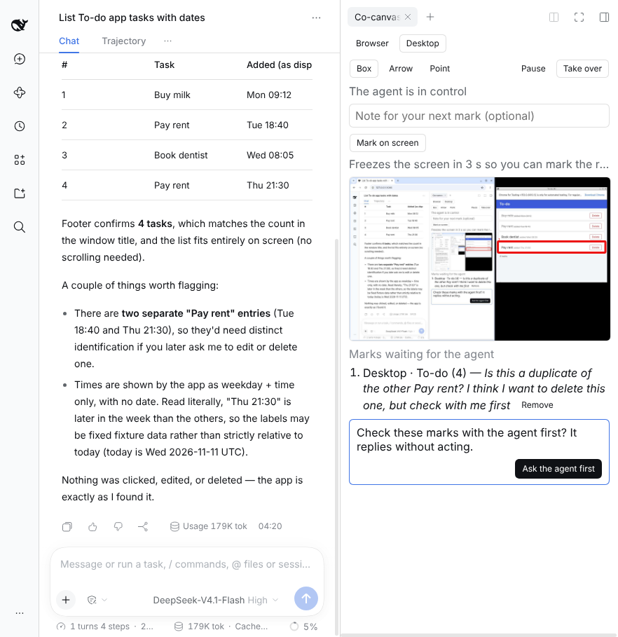
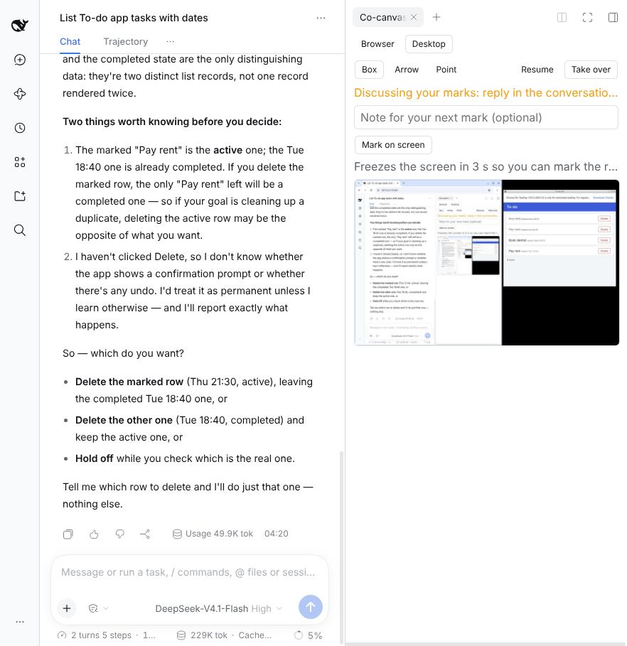
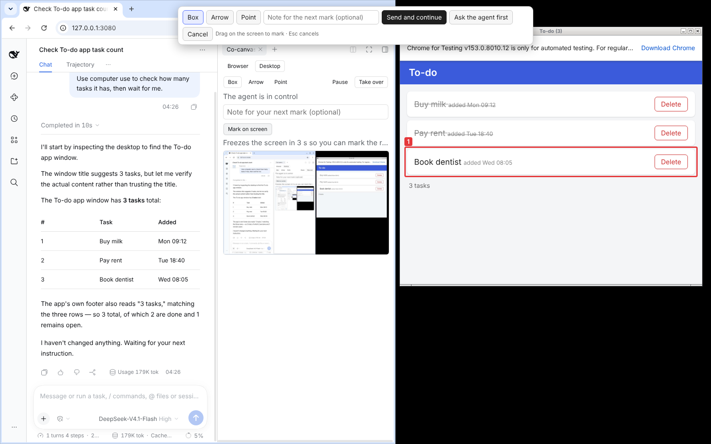

# harness-upgrade — multimodal input, long-term memory, cross-agent sessions and human-in-the-loop browser and computer use for DeepSeek Harness

[DeepSeek Harness](https://github.com/deepseek-ai/deepseek-harness) (`dsh`) is DeepSeek's open-source, all-plugin agent runtime. Out of the box its agents read text and single images; its own docs list PDF, audio and video as deferred and ship no built-in memory, and its browser and computer-use agents work alone, cut off from the user's other coding agents. This project adds all of that as **ten native dsh packages**, built only on dsh's documented extension points — no change to the agent loop — and held to dsh's own engineering gates.

| What an agent can now do | Package | Tool |
|---|---|---|
| Read PDF and Office files, including scanned pages | `dsh-tool-read-document` | `read_document` |
| Listen to recordings, with timestamps | `dsh-experimental-tool-read-audio` | `read_audio` |
| Watch videos as a timeline of keyframes and speech | `dsh-experimental-tool-read-video` | `read_video` |
| Use images on a text-only model (e.g. `deepseek-v4-pro`) | `dsh-vision-bridge` | `ask_image` |
| Remember facts and past sessions across sessions | `dsh-memory` | `memory_*`, `recall` |
| Work in a browser the user watches live, marks, and can take over | `dsh-experimental-co-canvas` + Web tab | `ask_user_to_mark` |
| Operate the desktop (computer use) while the user watches, marks windows, or marks the frozen screen | co-canvas `desktop` + official `dsh-experimental-computer-use-cua-driver-native` | `cua_driver_native__*` |
| Talk about a mark before acting: the agent answers, then waits for the user | co-canvas **Ask the agent first** | — |
| Open a Claude Code, Codex, or Gemini CLI session here and follow it live; share this conversation as their native session; share memory both ways | `dsh-experimental-agent-bridge` + Web tab | `external_sessions`, `open_external_session`, `share_session`, `external_memory` |
| (shared) command runner, cache, windows, image commits | `dsh-media-core` | — |

[`deepseek-harness/`](deepseek-harness) is the complete upgraded harness: the official `0.2.2-rc.1` release unchanged, with these packages added on top and registered where upstream registers new packages. Upstream's build, documentation gates and test suite run on the combined tree.

## Demos (real runs on the DeepSeek API)

**Co-canvas · Point instead of explaining.** The agent works in a shared browser whose window carries a small toolbar; the Web UI also shows it live in a side tab. The user boxes or points at something on the real page, with a note; each mark is resolved to the element underneath — `button "Submit" (2nd of 2 button elements with this text)` plus a CSS selector — and reaches the agent with its next tool result. Two real runs on a page with two identical "Submit" buttons — **[watch marking in the real browser window](docs/co-canvas-in-page-demo.mp4)** (72 s) or [in the Web tab](docs/co-canvas-demo.mp4) (77 s), both with Chinese captions:

- *The agent asks.* Told only to "press the Submit button", the agent noticed the ambiguity and called `ask_user_to_mark`; the user boxed Plan B and sent the mark; the agent clicked Plan B.
- *The user corrects mid-task.* Told to "submit Plan A", the agent was paused the moment the page appeared; the user boxed Plan B with "Change of plan" and resumed. The browser action the agent had already chosen was refused instead of run, and it re-planned: "You changed the plan to Plan B… Plan A was never submitted."

**Agent bridge · Claude Code, Codex, and Gemini CLI in one conversation.** Like Codex's import of Claude Code sessions, but live and in both directions. A real run on the DeepSeek API through the Web UI: asked about "a checkout bug I fixed in Claude Code yesterday", the agent searched with `external_sessions`, opened the Claude Code session, and summarised where it stopped. Claude Code then added two messages to that session; they arrived as a relayed update without waking the agent, and "what did Claude Code just do?" was answered from them (a regression test, `tests/cart.test.js`). "Share this with Codex and Gemini CLI" wrote the conversation as a native session of each and returned `codex resume <thread>` and `gemini --resume <id>`: the real Gemini CLI lists it, and the real Codex holds every message, extended after each later turn through Codex's own importer. Memory went both ways: the API base path came from Claude Code's project memory and "use pnpm" from Gemini CLI's, each cited by source, while DeepSeek Harness's "Postgres 16 only" was written into a marked block of `CLAUDE.md`, `AGENTS.md`, and `GEMINI.md`.

| A followed Claude Code session reports its new work | The Agent bridge tab |
|---|---|
|  |  |

**Co-canvas on the desktop · Ask before acting.** With the official Cua Driver computer-use provider enabled, the same tab shows the desktop live. A real run on the DeepSeek API, with a To-do app holding two "Pay rent" rows: the agent listed the tasks with computer use; the user boxed the Thursday row in the desktop view with the note "Is this a duplicate…? check with me first" and pressed **Ask the agent first**. The agent answered in the conversation (the two rows differ in date and state; deleting the active one may be the opposite of what you want) and touched nothing — its desktop actions are refused while the discussion lasts. The user replied "Yes, delete the one I marked"; the discussion ended by itself and the agent clicked that row's Delete and verified "To-do (3)". **Mark on screen** freezes the real screen full screen for marking: boxing "Book dentist" there with "What is this one for? Just tell me" got a description and no action.

| Box a window row on the desktop view | The agent answers without acting | Marking the frozen real screen |
|---|---|---|
|  |  |  |

| The agent asks; the user marks | The user corrects mid-task |
|---|---|
|  |  |


**1 · Fix a bug from a screen recording.** [`demos/1-video-bug`](demos/1-video-bug/shop) holds a tiny web shop and a 10-second Playwright recording in which Checkout throws. The agent watches the video, reads the error off the frame (`TypeError … reading 'price' (cart.js:11)`), finds the off-by-one loop, fixes it, and verifies the fix with Node. Change-ranked sampling picks 5 frames — one per UI change — and the last one is the error banner.

**2 · Meeting minutes from a recording.** [`demos/2-meeting/meeting.mp3`](demos/2-meeting/meeting.mp3) is a 58-second two-voice meeting synthesized with espeak-ng. `read_audio` transcribes it with the local SenseVoice model (downloaded and loaded on first use through the speech seam's preparation), and the agent writes [minutes](demos/2-meeting/meeting-minutes.example.md) with decisions, action items and open questions, each with a timestamp. It recovered the `/v1/relay` prefix, 120 requests per minute, the dead-letter queue after three attempts and the Friday deadline; robotic speech garbled the path's last segment and the owner's name, and the minutes flag both as low-confidence instead of guessing.

**3 · Implement a parser from a scanned spec.** [`demos/3-scanned-spec`](demos/3-scanned-spec) has a 2-page PDF whose field table is a scan with no text layer. `read_document` returns an outline flagging page 2 as "no text layer", the agent re-reads it as an image, writes `parse_header` (`>HBBIQ`) plus 14 pytest tests, and runs them; an independent hidden test also passes.

**Text-only model sees a screenshot.** On `deepseek-v4-pro`, `read_image` refuses; the agent switches to `ask_image`, `deepseek-flash` reads the screenshot, and only text returns.

**Memory across sessions.** Session 1: "our API base path is /v2/relay, never use print() for logging, Postgres 16 only." Session 2, fresh: "write a function that logs a startup message with our base path" → uses `structlog` and `/v2/relay` with no tool calls.

Reproduce after setup: `DEEPSEEK_API_KEY=… demos/run.sh 1` (or `3`).

## Evaluation: how should an agent look at a video?

12 synthetic 40-second dashboard recordings (ticking clock, one metric change, one alert banner shown for 2 s at a random time). The agent must call `read_video` once on the whole video and report the alert code. Same model, same prompt; only frame selection changes. Script: [`eval/video_eval.py`](eval/video_eval.py); raw runs: [`eval/results/`](eval/results).

| Frame selection | Frames per call | Alert found | Median input tokens |
|---|---|---|---|
| Change-ranked (ours) | **4** | **12 / 12** | **14.2k** |
| Change-ranked (ours) | 8 | 12 / 12 | 16.4k |
| Uniform (baseline) | 8 | 8 / 12 | 16.4k |
| Uniform (baseline) | 24 | 12 / 12 | 24.8k |

Uniform sampling needs 6× the frames and 1.75× the input tokens to match change-ranked selection at 4 frames. Medians are reported because two uniform runs fell back to extracting extra frames with bash (124k and 198k tokens).

**Why ranking, not a threshold.** ffmpeg's scene score is designed for film cuts (> 0.3). In a screen recording an error banner scored **0.13** and a one-line text change **~0.005**, so the usual 0.3 threshold kept only the first frame. `read_video` therefore scores every frame on a 320-px copy and keeps the first frame plus the largest changes, at least 1 s apart.

## Status

| Item | State |
|---|---|
| `read_document`, `read_video`, `ask_image`, `memory` | Done, verified end to end on DeepSeek |
| `read_audio` | Done, verified end to end with the real SenseVoice model (demo 2) |
| Co-canvas (shared browser, marks, pause/take over) | Done, verified end to end on DeepSeek through the real Web UI; Windows uses the built-in Edge |
| Agent bridge (open and follow Claude Code / Codex / Gemini CLI sessions, share live as their native sessions, two-way memory) | Done, verified end to end on DeepSeek through the Web UI with the real Codex and Gemini CLIs; resuming in Claude Code not exercised (needs a signed-in Claude Code) |
| Computer use + desktop co-canvas (desktop view, window-grounded marks, Mark on screen, Ask the agent first) | Done, verified end to end on DeepSeek on a Linux X11 desktop; the Cua Driver runtime ships Windows binaries, Windows not yet exercised |
| Subagents | Co-canvas marks and **Ask the agent first** go to the top-level conversation; a subagent's browser and desktop actions still wait while the user holds control. Memory stores and reflects on top-level turns only |
| Other model providers | Verified end to end through a custom OpenAI-compatible provider added in Settings → Models: `read_document` on a scanned PDF answered on that route |
| Speech output | Not started |

## Repository layout

```
deepseek-harness/  the upgraded harness: official 0.2.2-rc.1 plus this project's commits
install/           setup.ps1 (Windows), setup.sh, the dsh-mm launcher and plugin overlay
demos/             demo projects, recordings, fixtures, and run.sh
eval/              video benchmark (Python orchestrator, Playwright recorder) and results
docs/              screenshots, recordings, and engineering notes
memory/            Python prototype of the memory design (MCP server + dsh plugin)
relay/             Relay, a self-hosted inference gateway
```
