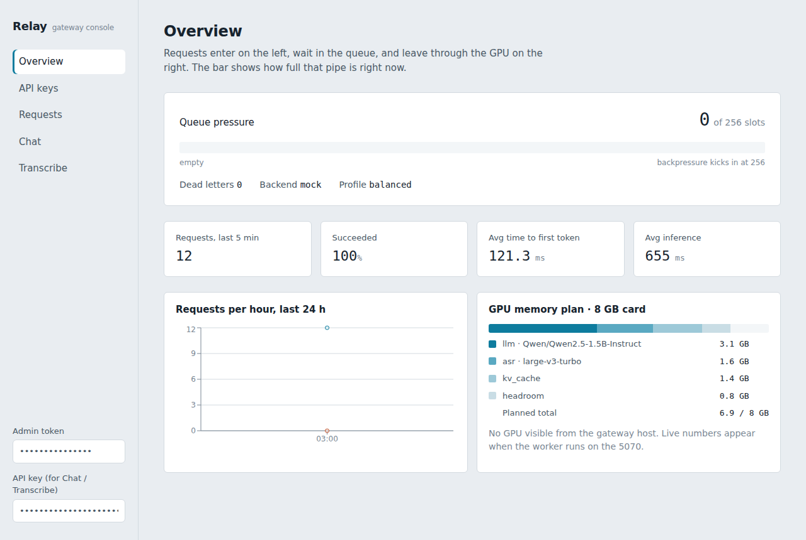

# Relay — self-hosted GPU inference gateway

An OpenAI-compatible API in front of a single consumer GPU (RTX 5070, 8 GB), with the parts that make it survive real traffic: API keys with per-key rate limits, an at-least-once job queue with crash recovery, dynamic batching on the worker, streaming responses, Prometheus metrics, a Next.js console and an Expo mobile dashboard with alerts.

Built as a portfolio project. Every design decision — and every bug hit along the way — is written up in [PROGRESS.md](PROGRESS.md).



## What it does

```
client ──HTTP/SSE──▶ Gateway (FastAPI) ──Redis Streams──▶ Worker pool ──▶ vLLM / faster-whisper
                       │ auth · quota · rate limit                 │ dynamic batching · at-least-once
                       │ idempotency · backpressure                │ XAUTOCLAIM crash recovery · DLQ
                       ◀────────────── Redis pub/sub (token stream) ◀
                       │
                       ├─▶ Postgres / SQLite   request log, hourly usage rollups
                       └─▶ /metrics            Prometheus → Grafana (10-panel dashboard + 4 alert rules)
```

- `POST /v1/chat/completions` — OpenAI-compatible, streaming and non-streaming, `Idempotency-Key` supported. Point the `openai` SDK at it by changing `base_url`.
- `POST /v1/audio/transcriptions` — Whisper via the same queue.
- `/admin/*` — keys, usage, recent requests, live status (drives the web console and the mobile app).
- `/metrics`, `/healthz`, `/readyz`.

## Quick start

One command, mock backend, no GPU needed:

```powershell
.\scripts\bootstrap.ps1          # Windows — add -Gpu for the real models
```
```bash
./scripts/bootstrap.sh           # macOS / Linux — add --gpu
```

It checks Docker, writes `.env`, starts everything, waits for `/readyz`, creates an API key, sends a test request and opens the console.

By hand:

```bash
# everything: gateway, 2 workers (mock backend), redis, postgres, prometheus, grafana, web console
docker compose up --build
# console  http://localhost:3000     grafana  http://localhost:3001     api  http://localhost:8000/docs

# make a key, send a request
curl -s -X POST localhost:8000/admin/keys -H "X-Admin-Token: change-me" \
     -H "Content-Type: application/json" -d '{"name":"demo"}'
curl -N localhost:8000/v1/chat/completions -H "Authorization: Bearer rly_…" \
     -H "Content-Type: application/json" \
     -d '{"messages":[{"role":"user","content":"hi"}],"stream":true}'
```

Real GPU worker (RTX 5070): see [docs/DEPLOY.md](docs/DEPLOY.md). Short version: install the **cu128** PyTorch wheel, then `docker compose --profile gpu up`.

Local dev without Docker:

```bash
pip install -r requirements-dev.txt
pytest -q                                  # 42 tests, fakeredis + SQLite, ~7 s
cd gateway && alembic upgrade head && uvicorn relay_gateway.main:app --reload
python -m relay_worker.main                # in another shell, PYTHONPATH=gateway:worker
cd web && npm i && npm run dev             # console on :3000
```

## Design decisions worth talking about

**Rate limiting is a Lua token bucket in Redis.** Read-refill-take-write must be atomic; doing it as separate GET/SET calls lets two concurrent requests both see the same balance and both pass. Token bucket rather than a fixed window because fixed windows admit 2× the limit at the boundary. Token-per-minute limits are reserved up front from `prompt + max_tokens` and settled after the response, since output length isn't known until the model finishes. *Test: 50 concurrent requests against a bucket of 20 admit exactly 20.*

**The queue is Redis Streams, not a list.** `LPUSH/BRPOP` is at-most-once — a worker that dies after popping loses the job. Streams with a consumer group keep un-acked messages in a pending list, and another worker reclaims them with `XAUTOCLAIM` after an idle timeout. That makes delivery at-least-once, which is why idempotency keys are enforced by a unique index in the database rather than in application code. *Test: worker A takes a job and dies; worker B can't steal it before the idle threshold, and picks up the same job id after.*

**Backpressure is a hard limit, not a bigger buffer.** Over `max_queue_depth` the gateway returns 503 with `Retry-After`. An unbounded queue just moves the failure later and makes it worse.

**Dynamic batching uses a window and a cap.** The worker waits at most `batch_window_ms` or until `max_batch_size` jobs arrive, whichever comes first — a bus that leaves when full or when the timer runs out, so early arrivals never starve. *Benchmark: 6 concurrent requests complete in 1.27 s versus 1.10 s for one.*

**Streaming and non-streaming share one code path.** The non-streaming response just collects the same event stream. Two implementations of the same thing drift.

**Results come back over pub/sub, not a second stream.** Tokens are fire-and-forget: if the client is gone, nobody wants them. Pub/sub drops messages with no subscriber instead of piling them up in Redis.

**Two models on one 8 GB card is a budgeting problem.** `MODEL_PROFILE` declares each model's VRAM footprint; the worker refuses to start if the plan doesn't fit and says which profile would. The default `balanced` profile runs Qwen2.5-1.5B-Instruct (FP16, 3.1 GB + 1.4 GB KV cache) next to faster-whisper large-v3-turbo (int8, 1.6 GB). The worker also checks for Blackwell (sm_120) and fails fast with the fix if PyTorch isn't a cu128 build — the actual error otherwise surfaces on the first forward pass, far from the cause.

**Latency is recorded in three pieces.** Queue wait, time-to-first-token and inference time are separate columns and separate histograms. A slow request with a long queue wait needs more workers; one with a long inference time needs a faster model. Conflating them hides which.

## Benchmark (mock backend, 1 CPU, fakeredis, single worker)

| concurrency | requests | throughput | p50 | p99 | queue wait p99 |
|---:|---:|---:|---:|---:|---:|
| 1 | 20 | 1.3 req/s | 769 ms | 1155 ms | 23 ms |
| 8 | 80 | 8.8 req/s | 897 ms | 1174 ms | 55 ms |
| 32 | 160 | **33.6 req/s** | 823 ms | 1326 ms | 150 ms |
| 8, streaming | 40 | 9.5 req/s | 768 ms | 1165 ms | TTFT p99 220 ms |

Throughput scales linearly with concurrency while p99 stays flat: the worker overlaps requests instead of serialising them. Queue wait p99 rising from 23 → 150 ms is the queue starting to fill — with a real GPU the same three numbers tell you when to add a second card.

Reproduce with `python scripts/loadtest.py --key rly_… --concurrency 32 --requests 160`.

## Agent harness

`harness/` is an agent runtime on top of the gateway: a tool-calling loop with Claude Code-style **hooks** (six events, Python or shell, `settings.json`-compatible), **three-tier memory** (AGENTS.md instructions → size-capped `MEMORY.md` the agent curates itself → FTS5-indexed episodic store with cross-session `recall`), a **reflect pass** that extracts durable facts after each turn, and **compaction** that rescues facts before summarising. Permission modes `suggest / auto-edit / full-auto` are implemented as a priority-0 hook. Also: parallel tool execution (reads concurrent, writes serialised), sub-agents with isolated context and inherited hooks, and an MCP stdio client that registers external servers' tools as `mcp__<server>__<tool>`. Every behaviour is unit-tested against a scripted model. See [harness/README.md](harness/README.md).

## Repository layout

```
gateway/relay_gateway/   FastAPI app: api/ core/ db/ queue/ obs/
worker/relay_worker/     queue consumer, backends/ (mock · local HF · vLLM · faster-whisper)
harness/relay_harness/   agent runtime: hooks, tiered memory, compaction, policy, REPL
web/                     Next.js 15 console (overview, keys, requests, chat, transcribe)
app/                     Expo / React Native dashboard with local alerts
deploy/                  prometheus config + alert rules, grafana dashboard + provisioning
tests/                   pytest suite (rate limit, queue semantics, HTTP API, admin, audio)
scripts/loadtest.py      benchmark tool
docs/                    DEPLOY.md, screenshots
PROGRESS.md              build log: what was built, why, what broke, how it was fixed
```

## Stack

Python 3.12 · FastAPI · SQLAlchemy 2 (async) · Alembic · Redis 7 (Streams, pub/sub, Lua) · Postgres 16 / SQLite · vLLM · faster-whisper · Prometheus · Grafana · OpenTelemetry (optional) · Next.js 15 · React 19 · Recharts · Expo 52 · Docker Compose · GitHub Actions · pytest · ruff

## Resume lines

> Built **Relay**, a self-hosted OpenAI-compatible inference gateway (FastAPI, Redis Streams, Postgres) serving Qwen2.5 and Whisper on a single 8 GB RTX 5070 — per-key Lua token-bucket rate limiting, at-least-once job queue with XAUTOCLAIM crash recovery, dynamic batching, SSE streaming, idempotency keys and backpressure; 33 req/s at p99 1.3 s in load tests.

> Built an agent **harness** on top of it: Claude Code-compatible hook system (PreToolUse/PostToolUse/PreCompact… with deny/modify/inject), three-tier memory (instruction files, a size-capped fact store the agent curates, FTS-indexed episodic recall), a post-turn reflect pass, fact-preserving compaction, parallel tool execution, sub-agents and an MCP client — all deterministically tested via a scripted model.

> Instrumented it end to end (Prometheus histograms for queue wait / TTFT / inference, structured logs keyed by request id, Grafana dashboard + alert rules) and shipped a Next.js console and an Expo mobile dashboard with threshold alerts.

## License

MIT
